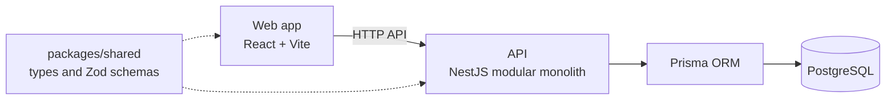

# TaskForge — Multi-Tenant Project Management SaaS

> **Reference Only — All Rights Reserved**
>
> This repository is publicly available for portfolio presentation and technical evaluation only. Public visibility does not grant permission to deploy, operate, commercially use, modify, redistribute, or create derivative works from this software. Any additional use requires prior written authorization under the applicable license and subject to applicable law. All rights not expressly granted are reserved.
>
> See [LICENSE](LICENSE). To request permission for additional use, contact majeed.developer0@gmail.com.


## Overview

TaskForge is a multi-tenant project management application built as a TypeScript monorepo: a NestJS API, a React web app and a shared package for types and validation. It is published as a portfolio piece to show architecture, API design and full-stack engineering.

## Highlights

- **Multi-tenant model:** organizations with memberships and invitations, and projects with their own memberships and roles.
- **Modular monolith API:** twelve feature modules on NestJS (Fastify) with shared guards, filters, interceptors, pipes and DTOs.
- **Authentication design:** JWT with refresh tokens, plus password-reset and email-verification tokens, with Argon2 password hashing.
- **Typed end to end:** a shared package defines API response shapes, enums, pagination and permissions with Zod, used by both the API and the web app.
- **Operational touches:** structured logging (Pino), Helmet, rate limiting, Swagger/OpenAPI and a health endpoint.
- **Documented decisions:** architecture document and four architecture decision records.

## Architecture



The API is a **modular monolith**: one deployable service split into feature modules. The full write-up covers the request lifecycle, module map, token lifecycle, database design, frontend architecture and the response and error contract: [docs/ARCHITECTURE.md](docs/ARCHITECTURE.md).

Architecture decision records (`docs/adr/`): modular monolith, Prisma ORM, authentication strategy and tenancy model.

## API Modules

| Module | Area |
| --- | --- |
| `auth`, `users` | Accounts, sign-in and token lifecycle |
| `organizations`, `memberships`, `invitations` | Tenants, who belongs to them, and invitations |
| `projects` | Projects and project membership |
| `tasks`, `labels`, `comments` | Work items, labelling and discussion |
| `notifications`, `activity` | User notifications and an activity log |
| `dashboard`, `health` | Dashboard data and service health |

## Data Model

Defined in Prisma (PostgreSQL):

| Group | Models |
| --- | --- |
| Identity | `User`, `RefreshToken`, `PasswordResetToken`, `EmailVerificationToken` |
| Tenancy | `Organization`, `OrganizationMembership`, `Invitation` |
| Work | `Project`, `ProjectMembership`, `Task`, `Label`, `TaskLabel`, `Comment` |
| Engagement | `Notification`, `ActivityLog` |

Enums cover membership roles, invitation status, project status, project member roles, task status, task priority, notification types and activity actions.

## Frontend

React with React Router and TanStack Query for data fetching, React Hook Form with Zod for forms, Radix UI components, dnd-kit for drag and drop, Recharts for charts and Sonner for notifications. Pages: authentication, onboarding, dashboard, projects, members, notifications and settings.

## Technology Stack

| Area | Technologies |
| --- | --- |
| Backend | NestJS on Fastify, Prisma ORM (`pg` adapter), PostgreSQL, JWT, Argon2, Zod, Pino, Helmet, `@nestjs/throttler`, Swagger |
| Frontend | React, React Router, TanStack Query, React Hook Form, Zod, Radix UI, dnd-kit, Recharts, Sonner, Lucide |
| Shared | TypeScript package with Zod schemas |
| Tooling | npm workspaces, ESLint, Prettier, Docker (API and web Dockerfiles, Compose file with `postgres`, `api` and `web` services) |

## Repository Structure

```
apps/
  api/        NestJS API (modules, common, config, database, health)
  web/        React web app (pages, features, components, routes)
packages/
  shared/     Shared TypeScript types and Zod schemas
prisma/       Prisma schema, migrations and seed script
docs/         Architecture, implementation plan and ADRs
docker-compose.yml
```

## Local Evaluation (Reference Only)

The scripts below exist in `package.json`. They are provided so a reviewer can run the project **locally for personal technical evaluation**, as permitted by the [LICENSE](LICENSE). Deploying or hosting it is not permitted without written authorization.

```
npm install              # also builds the shared package
npm run db:generate      # generate the Prisma client
npm run db:migrate:dev   # create the database schema
npm run db:seed          # seed data
npm run dev:api          # start the API
npm run dev:web          # start the web app
```

An environment template is provided in `.env.example`, and `docker-compose.yml` defines a local PostgreSQL service.

| Script | Purpose |
| --- | --- |
| `npm run typecheck` | Type-check shared, API and web |
| `npm run lint` / `npm run format:check` | ESLint and Prettier checks |
| `npm run test:api` / `npm run test:web` | API and web unit tests |
| `npm run build` | Build shared, API and web |
| `npm run db:studio` | Open Prisma Studio |

## Documentation

- [Architecture](docs/ARCHITECTURE.md)
- [Implementation plan](docs/IMPLEMENTATION_PLAN.md)
- [Architecture decision records](docs/adr/)

## Contributing

This project is published for reference and portfolio evaluation and is not open to outside contributions or pull requests. See [LICENSE](LICENSE) for the use that is permitted, and contact me to request any additional permission.

## License

Copyright (c) 2026 Abdul Majeed. All rights reserved.

This project is published under a custom **Reference-Only Source-Available License**. It is **not** an open-source license. See [LICENSE](LICENSE). Deployment, commercial use, modification and redistribution require prior written authorization. Permission requests: majeed.developer0@gmail.com