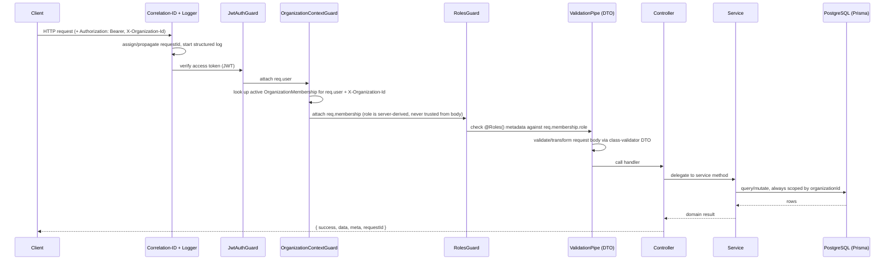
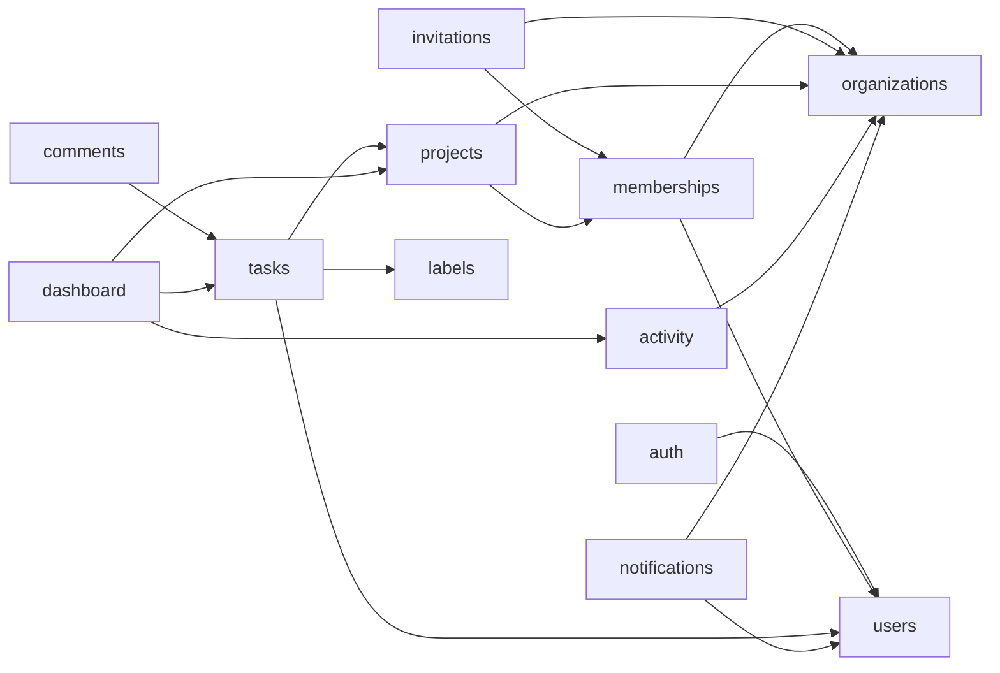
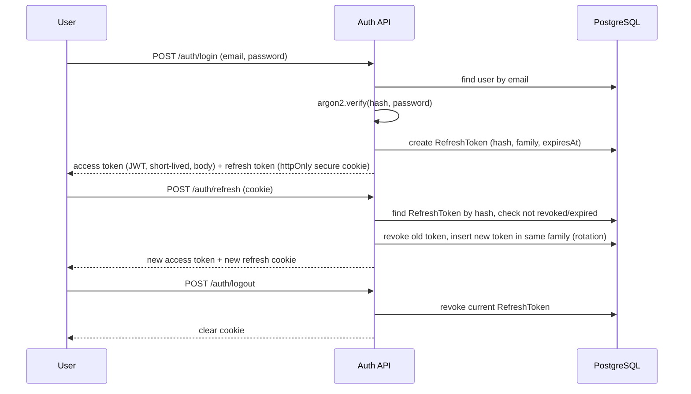
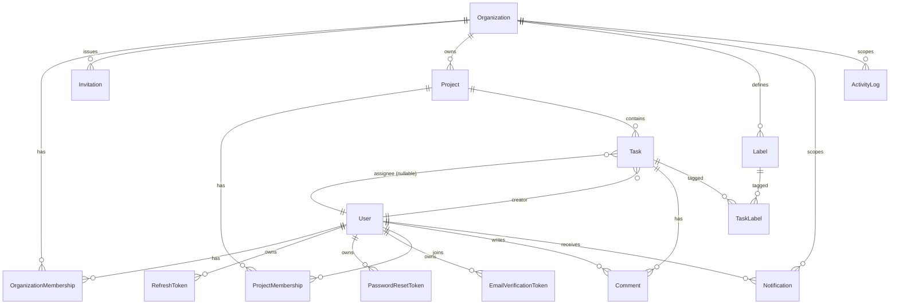

# TaskForge — Architecture

## 1. Style: modular monolith

TaskForge is a single NestJS application (`apps/api`) organized into cohesive
feature modules under `src/modules/*`, plus a single React SPA (`apps/web`). There
is no microservice split: at this scale, network boundaries between services would
add latency, operational burden, and distributed-transaction complexity without a
corresponding benefit. Module boundaries are enforced at the code level instead:

- Each feature module exposes a `*.controller.ts` (HTTP only — no business logic),
  a `*.service.ts` (business rules, authorization checks, transactions), and its own
  DTOs. Controllers depend on services; services depend on Prisma and other
  services via constructor injection; nothing reaches into another module's
  internals directly.
- Cross-module reads (e.g. tasks needing to validate a project belongs to the
  caller's organization) go through the owning module's service, not through ad hoc
  Prisma queries scattered across the codebase.
- See `docs/adr/0001-modular-monolith.md` for the full decision record.

## 2. Backend request lifecycle



Every authorization-sensitive query includes `organizationId` in its `WHERE`
clause, derived from `req.membership` (set by `OrganizationContextGuard` from a
verified membership row), never from a client-supplied `organizationId` in the
request body. This is the core of tenant isolation — see `docs/SECURITY.md` §4.

## 3. Module map



`common/` holds cross-cutting code with no business meaning of its own: guards,
the global exception filter, the response-shaping interceptor, decorators
(`@CurrentUser()`, `@ActiveOrganization()`, `@Roles()`), and the correlation-ID
middleware. `config/` validates `process.env` with Zod at boot and exposes a typed
config object — the app refuses to start on invalid configuration rather than
running with silently wrong defaults.

## 4. Authentication & token lifecycle



- Access tokens are short-lived JWTs returned in the JSON body and held in memory
  on the client (not `localStorage`, to limit XSS blast radius) — see
  `docs/SECURITY.md` for the full rationale and its limitations.
- Refresh tokens are opaque random values; only their SHA-256 hash is stored, set
  as an `httpOnly`, `secure`, `sameSite=lax` cookie scoped to `/api/v1/auth`.
  Presenting a refresh token twice (reuse of an already-rotated token) revokes the
  entire token family as a theft signal.
- Password reset and email verification follow the same hash-only-stored,
  single-use, expiring token pattern (`PasswordResetToken`, `EmailVerificationToken`).

## 5. Initial database design

Full details, indexes, and migration/seed/backup workflow are in
`docs/DATABASE.md`. This is the entity overview produced during planning:



## 6. Frontend architecture

- `src/app`: providers (QueryClient, router, auth context, theme).
- `src/pages`: route-level components composed from `features/*`.
- `src/features/*`: one folder per domain (auth, organizations, projects, tasks,
  notifications, settings) — colocates hooks, API calls, and components for that
  domain.
- `src/components/ui`: generic, domain-agnostic primitives (Button, Input, Dialog,
  Badge, Table, …) built on Radix primitives + `class-variance-authority`, styled
  with Tailwind. No business logic lives here.
- `src/services`: typed API client wrapping `fetch`, attaching the access token,
  handling 401 → silent refresh → retry, and translating the backend's error
  contract into typed errors.
- `src/lib`: framework-agnostic helpers (date formatting, query-key factories).
- Server state (anything from the API) lives in TanStack Query; local UI state
  (open/closed, form drafts) lives in component state or React Hook Form. There is
  no separate global client-state library — it isn't needed for this app's shape.

## 7. Response & error contract

See `docs/API_GUIDE.md` for full details and examples. Summary:

```ts
// success
{ success: true, data: T, meta?: { page, pageSize, total, totalPages }, requestId: string }
// error
{ success: false, error: { code: string, message: string, details?: unknown[] }, requestId: string }
```

Implemented once, centrally: a global `ResponseInterceptor` wraps successful
controller returns, and a global `AllExceptionsFilter` catches everything
(`HttpException`, Prisma errors, unexpected errors) and maps it to the error shape,
stripping stack traces and SQL details in production.

## 8. Key design decisions (see `docs/adr/` for full records)

| Decision | Summary |
|---|---|
| ADR 0001 | Modular monolith over microservices |
| ADR 0002 | Prisma as the ORM (typed queries + migrations over a hand-rolled query layer) |
| ADR 0003 | JWT access token + rotating opaque refresh token over pure stateless JWT or server-side sessions alone |
| ADR 0004 | Tenancy via a required `organizationId` column + server-derived membership context, not a separate schema/database per tenant |
